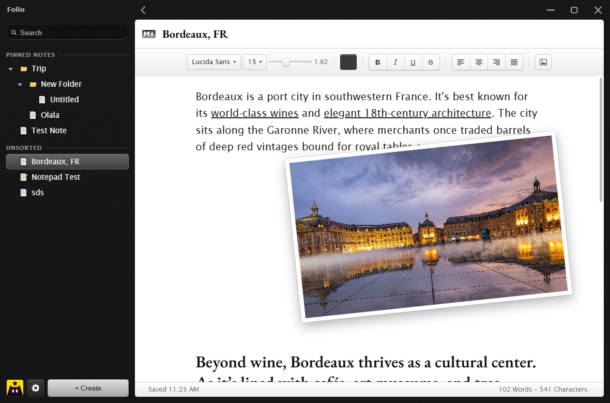

# Folio

A classic notes app that looks like it shipped with Mac OS X in 2011. Blurred dark
sidebar, beveled controls, and a white typing field — built via Tauri 2.


## Running it

Two ways, and both are useful.

**Browser preview** — fastest path for design work. The frontend has no build
step, so any static server works:

```powershell
python -m http.server 4174 --directory src
```

Then open <http://127.0.0.1:4174>. Without `window.__TAURI__` the app falls
back to an in-memory vault, so every interaction is still clickable.

**Desktop app** — needs the Rust toolchain (the frontend needs nothing):

```powershell
pwsh -File tools/tauri.ps1 dev      # compile and launch
pwsh -File tools/tauri.ps1 build    # release build + NSIS installer
pwsh -File tools/tauri.ps1 run      # launch the last release build
```

That script exists because two things on this machine are not where you would
expect: scoop installs rustup into `persist\rustup` (so cargo is not on PATH),
and we build with the **GNU** toolchain because the MSVC Build Tools are not
installed. See the header of `tools/tauri.ps1` for the MSVC path, which is the
one Tauri officially supports.

## Layout

```
src/                 the frontend, served as-is (no bundler)
src/js/markdown.js   markdown <-> editor HTML, the only part with tests
src-tauri/           Rust backend, window config, capabilities
tools/make_icons.ps1 regenerates the whole icon set from one source PNG
tools/markdown.test.js   35 checks, `bun tools/markdown.test.js`
tools/tauri.ps1      dev / build / run, with this machine's env quirks handled
PLAN.md              design system, architecture, roadmap
```

## Where the notes live

Notes are ordinary **markdown files in a folder you pick** — defaulting to
`Documents/Notes`, changeable from the gear button in the sidebar. Subfolders
are real subfolders, so the sidebar tree is just a listing of your directory
and you can edit the files in any other editor, back them up, or sync them.

The one exception is that `.trash/` and `.attachments/` are hidden from the
tree. Deletes move a note to `.trash/` rather than unlinking it, and writes are
atomic (write a sibling `.tmp`, then rename) so a crash mid-save cannot
truncate a note.

Markdown is the storage format, so `src/js/markdown.js` converts both ways and
is the only frontend logic with real edge cases:

```powershell
bun tools/markdown.test.js     # 35 checks, including a full round trip
```

Underline is written as inline `<u>` and the yellow highlight as `==mark==`,
since neither has a markdown equivalent. Images are stored inline as data URIs,
percent-encoded so an SVG payload's brackets cannot break the link.

## Notes on the build

- **No JavaScript toolchain.** `frontendDist` points straight at `src/` and
  `withGlobalTauri` exposes `window.__TAURI__`, so there is no npm install
  anywhere in this repo.
- **The window is borderless and transparent** (`decorations: false`), with a
  **Windows caption bar** — minimise, maximise/restore and close on the right,
  wired to the real window, and the rest of the top strip drags the window.
- **The OS owns the material and the corners.** The sidebar gets real
  **Aero blur** via `window-vibrancy`'s `apply_blur`, so it blurs your actual
  desktop rather than a CSS gradient. Acrylic was tried first and rejected: on
  Windows 10 it recomputes a noise layer every frame while dragging, which made
  moving the window crawl. There is also **no CSS `backdrop-filter` in the app**
  — one blur only, and the browser preview fakes its glass behind
  `html:not(.tauri)` so the two can never stack. Which material the OS accepted
  is recorded in `%APPDATA%\com.nick.notes\material.log`, because the effect
  cannot be seen in a screenshot of the window itself.
- **The build output lives outside the repo.** `CARGO_TARGET_DIR` points at
  `~\notes-target`, because the GNU resource compiler cannot handle a space in
  `$OUT_DIR` — `embed-resource` passes it to `windres` as `--include-dir`, which
  forwards it to `cc1` unquoted, so `...\Default Project\...` is truncated at
  the space. See the header of `tools/tauri.ps1`.
- **Icons are generated from one source PNG.** `pwsh -File tools/make_icons.ps1`
  renders the PNGs, the multi-size `.ico` and the `.icns` with .NET's imaging —
  no Pillow, no ImageMagick — and hand-assembles the icon containers, because
  nothing on this machine will write a multi-size icon for you. The source lives
  at `src-tauri/icons/source.png`; nothing is ever upscaled beyond it.
- **The backend is small on purpose:** `vault`, `set_vault`, `reveal_vault`,
  `create_folder`, `read_note`, `write_note`, `delete_note`, `rename_note`.

## Status

**Building and running.** The desktop app compiles and launches on this machine
with the GNU toolchain, and the notes folder, autosave, rename and the markdown
round trip all work against real files on disk.



Not done yet: the toolbar is still `execCommand`-based, deleting from the
sidebar has a backend command but no UI, and the acrylic tint needs judging on
an actual desktop (a `PrintWindow` capture cannot show the DWM backdrop). See
[PLAN.md](PLAN.md) for the roadmap.

