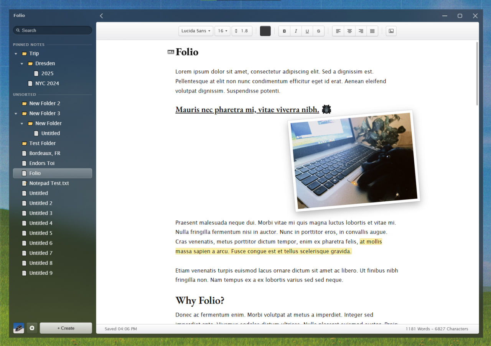

(docs/Folio Galaxy.png)

# Folio

An old school inspired notes app with a classic UI design, a small and simple alternative to Obsidian Notes.



## Running it

[Bun](https://bun.sh) is required.

```
bun install
bun start
```

An installer is `bun run dist`. That path has not been tested yet.

## Testing

```
bun tools/markdown.test.js
```

73 checks on the markdown converter. Besides the obvious cases, it reads a
document back and writes it again, and expects the same text both times.

## What's where

```
src/                  the app: index.html, js/markdown.js, assets
electron/main.js      window, IPC, caption buttons
electron/preload.js   the bridge the page uses instead of window.__TAURI__
electron/vault.js     notes, folders and settings on disk
electron/material.js  the Windows blur behind the sidebar
electron/icons/       app icon and its source
tools/                icon and font generation, tests
```

The page was written for Tauri first and still calls `window.__TAURI__`.
`electron/preload.js` provides that, so the frontend did not change when the
app moved to Electron.

## Notes location

Default path is `Documents/Notes` unless you pick another folder from the gear
menu. Subfolders are real subfolders, so the tree is just the folder.

Deleting moves a note or folder into `.trash/` instead of removing it. Saving
writes a temp file and renames it, so an interrupted save can't leave half a
note behind.

Settings are located in `%APPDATA%\com.nick.notes\settings.json`.

Pictures are stored inside the note as data URIs, and their frame position goes
in the image title (``). The note stays valid
markdown and the frames come back where you left them.

The blur behind the sidebar is native Windows material. Electron only does acrylic on
Windows 11, so Windows 10 is handled directly in `electron/material.js`. If the
call fails the window uses a solid colour instead.

## Status

Works on Windows: notes on disk, autosave, rename, pin, search, photo frames,
per-note font and spacing, undo, etc.
Not built as an installer yet.
MacOS support is planned in the future.

## Credits

[Jace](https://ja.mt) - Providing the [highlighter markers](https://highlighte.rs). /// [ios7jbpro](https://ios7.xyz) - App contributions.
