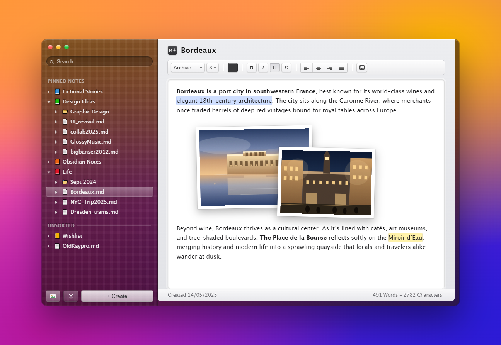

# Folio

A classic notes app that looks like it shipped with Mac OS X in 2011. Blurred dark
sidebar, beveled controls, and a white typing field — built with **Electron**.



## Running it

Two ways, and both are useful.

**Browser preview** — fastest path for design work. The frontend has no build
step, so any static server works:

```powershell
python -m http.server 4174 --directory src
```

Then open <http://127.0.0.1:4174>. Without the desktop bridge the app falls back
to an in-memory vault, so every interaction is still clickable.

**Desktop app** — needs [bun](https://bun.sh) once, then:

```powershell
bun install     # electron, electron-builder, koffi
bun start       # launch
```

To produce an installer:

```powershell
bun run dist    # NSIS installer in dist/
```

## Layout

```
src/                 the frontend, served as-is (no bundler)
src/js/markdown.js   markdown <-> editor HTML, the only part with tests
electron/main.js     the window, the IPC channel, window controls
electron/preload.js  the small window.__TAURI__-shaped bridge the page talks to
electron/vault.js    the vault, settings and note files
electron/material.js the Windows window material (DWM, via koffi)
electron/icons/      app icon, source and generated sizes
tools/make_icons.ps1 regenerates the whole icon set from one source PNG
tools/markdown.test.js   73 checks, `bun tools/markdown.test.js`
PLAN.md              design system, architecture, roadmap
```

The renderer is untouched by the port: `src/index.html` and `src/js/markdown.js`
are the same files the Tauri build used. `electron/preload.js` provides the small
`window.__TAURI__` surface they were written against — `invoke`, `dialog.open`,
`window.getCurrentWindow()`, and drag-drop events — so the frontend needed a shim,
not a rewrite.

The Tauri build is not gone: it is in the history of this branch (commit
`1315bfc`) and on the `electron` branch as it was before the port.

## Where the notes live

Notes are ordinary **markdown files in a folder you pick** — defaulting to
`Documents/Notes`, changeable from the gear button in the sidebar. Subfolders
are real subfolders, so the sidebar tree is just a listing of your directory
and you can edit the files in any other editor, back them up, or sync them.

The one exception is that `.trash/` and `.attachments/` are hidden from the
tree. Deletes move a note to `.trash/` rather than unlinking it, and writes are
atomic (write a sibling `.tmp`, then rename) so a crash mid-save cannot
truncate a note.

The Electron build reads the **same settings file** the Tauri build used,
`%APPDATA%\com.nick.notes` — so the notes folder, per-note fonts, sizes, spacing,
pins and the open note all carry over with no migration.

Markdown is the storage format, so `src/js/markdown.js` converts both ways:

```powershell
bun tools/markdown.test.js     # 73 checks, including a full round trip
```

Underline is written as inline `<u>` and the yellow highlight as `==mark==`,
since neither has a markdown equivalent. Images are stored inline as data URIs,
percent-encoded so an SVG payload's brackets cannot break the link.

## Notes on the build

- **No JavaScript build step.** `main.js` loads `src/index.html` straight from
  disk. bun is only the package manager (for Electron itself) and the test
  runner; there is no bundler and no transpiling anywhere.
- **The window is borderless and transparent**, with a **Windows caption bar** —
  minimise, maximise/restore and close on the right, wired to the real window —
  and the rest of the top strip drags it (`-webkit-app-region: drag`).
- **The material is the OS's.** `electron/material.js` calls the same
  `SetWindowCompositionAttribute` the Rust build used, through `koffi`, because
  Electron's own `backgroundMaterial` is Windows 11 only. Acrylic at rest, the
  cheaper Aero blur while the window moves — moving is where acrylic's
  per-frame noise layer used to crawl. If the call is refused, the window falls
  back to the solid Classic colour rather than showing a sharp desktop through
  the sidebar.
- **Icons are generated from one source PNG.**
  `pwsh -File tools/make_icons.ps1` renders the PNGs and the multi-size `.ico`
  with .NET's imaging — no Pillow, no ImageMagick — and hand-assembles the icon
  container. The source lives at `electron/icons/source.png`.
- **The backend is small on purpose:** `vault`, `set_vault`, `reveal_vault`,
  `create_folder`, `read_note`, `write_note`, `delete_note`, `rename_note`,
  `rename_folder`, `delete_folder`, `move_entry`, `import_files`, `set_order`,
  `set_pinned`, `settings` and the per-note setters.

## Status

**Building and running on Electron.** The notes folder, autosave, rename, pinning,
search, read mode, framed pictures and the markdown round trip all work against
real files on disk, and the settings are shared with the Tauri build.


See [PLAN.md](PLAN.md) for the roadmap.
